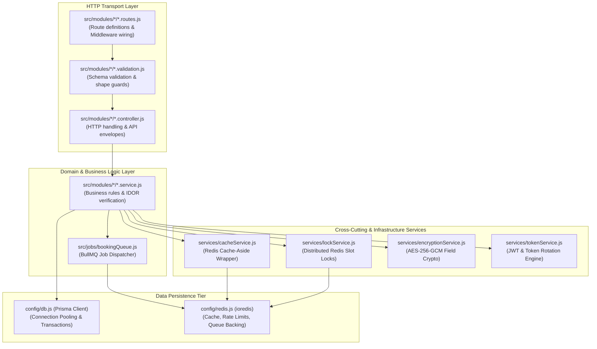
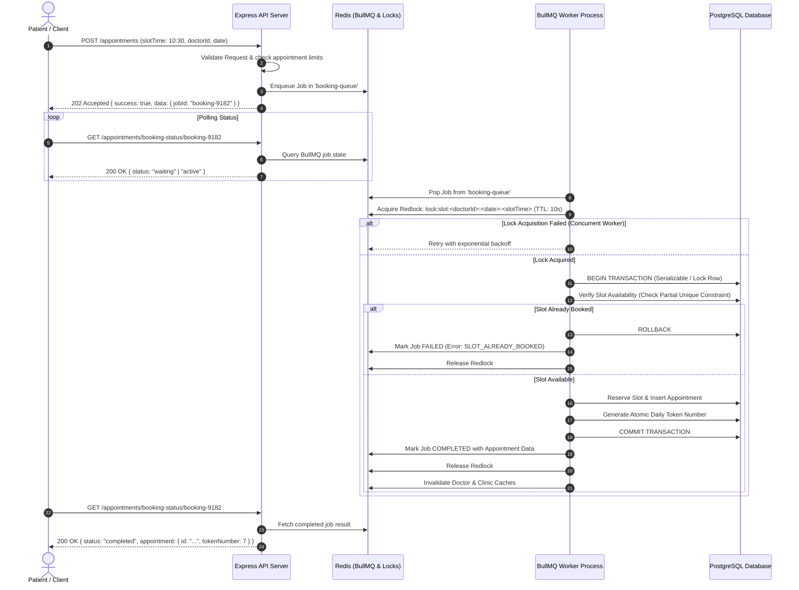

# BookMyDoctor24 — Backend System & Engineering Architecture

This document provides a comprehensive deep dive into the backend engineering architecture of **BookMyDoctor24** (located under `server/server/`).

---

## 🏗️ Architectural Overview & Core Principles

The backend is built with **Node.js (18+)**, **Express**, **Prisma ORM (PostgreSQL 16)**, and **BullMQ (Redis 7)**. It follows a **3-Tier Layered Modular Domain Design**:



### Key Architectural Tenets:
1. **Thin Routes & Controllers:** Routes only mount middleware. Controllers only parse HTTP requests and format standard API envelopes. Zero business or database logic resides in controllers.
2. **Domain Service Isolation:** All business decisions, authorization checks, role-based field filtering, and transactions live in `*.service.js`.
3. **Fail-Open Caching:** Redis caching failures never terminate a request; any Redis error falls back to PostgreSQL querying.
4. **Asynchronous Waiting Room:** The high-concurrency booking path decouples HTTP receipt from slot reservation via BullMQ background jobs.

---

## ⚙️ Process Lifecycle & Server Assembly

### 1. Multi-Process Architecture
The backend stack runs as **two distinct Node.js processes**:
1. **API Server (`npm run dev` / `src/server.js`):** Listens on port `4000`. Handles synchronous HTTP traffic, token refreshes, queries, and enqueues background jobs.
2. **Queue Worker (`npm run worker` / `src/jobs/worker.process.js`):** Dedicated BullMQ worker process. Consumes booking jobs from Redis, executes distributed locking, handles database transactions, and assigns sequential tokens.

> **Why a separate worker process?**
> A burst of 1,000 patients booking simultaneously creates database contention and transaction serialization. Isolating the worker guarantees that queue processing never starves the HTTP event loop, keeping browse, search, and health-check latency fast.

### 2. Express Middleware Pipeline (`src/app.js`)
Middleware ordering in `src/app.js` is engineered for security and performance:

```text
1. Sentry.init()                  -> Initializes global crash & unhandled exception capture
2. app.set('trust proxy', hops)   -> Sets exact reverse proxy hop count for accurate req.ip
3. requestContextMiddleware        -> Stores req.id and req.ip in AsyncLocalStorage
4. cors({ credentials: true })     -> Validates exact origin allowlist (before HTTPS redirect)
5. helmet()                        -> Injects CSP, CORP, HSTS, X-Content-Type-Options
6. compression()                   -> Gzip/Brotli response compression
7. express.raw()                   -> Captures untouched raw buffer ONLY for /payments/webhook/razorpay
8. express.json({ limit: '1mb' })  -> Parses JSON bodies with a 1MB payload ceiling
9. cookieParser()                  -> Parses httpOnly refresh token cookies
10. requestLogger                  -> Logs HTTP method, path, status, and duration with Request ID
11. defaultLimiter                 -> Global rate limiter (300 req/min/IP with user-ID priority)
12. secureDocument.routes          -> Authenticated serving for private KYC documents
13. express.static(/uploads)       -> Public static file server (avatars, clinic QR codes)
14. swaggerUi                      -> Interactive Swagger UI (disabled in production)
15. routes                         -> Central router mounting all 20 business domain routers
16. notFound                       -> Catch-all 404 handler returning standard error envelope
17. errorHandler                   -> Centralized error handler capturing ApiError & Prisma codes
```

---

## 🔄 The BullMQ Waiting-Room Booking Engine

Booking healthcare appointments under peak load (e.g. morning OPD slot releases) is a classic high-concurrency race condition. BookMyDoctor24 resolves this using a **Distributed Waiting Room**:



### Worker Concurrency Tuning
The worker concurrency defaults to `8` (`BOOKING_WORKER_CONCURRENCY=8`). Database connection pooling (`DB_POOL_SIZE=5` or higher) is scaled proportionally to ensure worker threads do not exhaust PostgreSQL connection pools.

---

## ⚡ Caching Architecture (`cacheService.js`)

All high-throughput, read-heavy operations utilize an enterprise **Cache-Aside Pattern** backed by Redis:

### 1. TTL Hierarchy
| Category | TTL | Target Data | Invalidation Policy |
|---|---|---|---|
| **Live Queue** | **10 seconds** | `GET /queue` (Current token being called) | Short TTL + Immediate on status mutation |
| **Operational Data** | **30 seconds** | User appointments, notifications, payments list | Explicit invalidation on status change |
| **Directory / Reference** | **60 seconds** | Doctors directory, clinics list, geography data | Explicit on profile/schedule updates |
| **Admin Aggregates** | **30 seconds** | Dashboard stats, system metrics | TTL-only (Too many write paths to track) |

### 2. Strict Role-Scoped Cache Keys
To prevent authorization and data-leakage vulnerabilities (e.g. leaking admin financial amounts or another patient's records):
- **Rule:** If an endpoint's output varies by caller, the cache key **must** encode the caller's role and user ID:
  ```text
  cache:appointments:list:patient:<patientId>:<status>:<page>
  cache:appointments:list:doctor:<doctorId>:<status>:<page>
  cache:appointments:list:clinic:<clinicId>:<status>:<page>
  ```
- Public directory lookups are keyed strictly by query parameters:
  ```text
  cache:doctors:list:<specialization>:<city>:<search>:<page>
  ```

### 3. Non-Blocking Invalidation (`SCAN` + `UNLINK`)
When an appointment is booked or a doctor profile is updated, cached lists must be purged:
- Traditional `KEYS cache:doctors:*` blocks the Redis single thread, introducing latency spikes.
- `cacheService.js` uses cursor-based `SCAN` batches paired with non-blocking `UNLINK`, removing keys asynchronously in background threads.

---

## 🔒 Distributed Slot Locking (`lockService.js`)

To guarantee strict isolation before database writes begin, `lockService.js` provides distributed mutex locks using Redis:
- **Key Pattern:** `lock:slot:<doctorId>:<date>:<slotTime>`
- **Acquisition:** `SET key workerId NX PX 10000` (Acquire only if key does not exist; auto-expire after 10,000ms).
- **Safe Release:** A Lua script checks that the lock value still matches the caller's unique `workerId` before executing `DEL`, preventing a slow worker from accidentally releasing a lock acquired by another process.

---

## 🗃️ Database Connection Management & Resilience

### 1. Connection Pool Sizing
Configured in `src/config/db.js` via dynamic query string parameters appended to `DATABASE_URL`:
- `connection_limit`: Configurable via `DB_POOL_SIZE` (default `5`).
- `pool_timeout`: Configurable via `DB_POOL_TIMEOUT_SECONDS` (default `10s`).
- Formula for multi-replica deployments:
  $$\text{Total Connections} = (\text{API Replicas} + \text{Worker Instances}) \times \text{DB\_POOL\_SIZE} < \text{Postgres Max Connections}$$

### 2. Database Constraints & Triggers
The architecture delegates data integrity invariants directly to the PostgreSQL engine:
- **Double-Booking Partial Unique Index:**
  ```sql
  CREATE UNIQUE INDEX idx_unique_active_slot ON appointments (doctor_id, appointment_date, slot_time)
  WHERE status NOT IN ('cancelled', 'rejected');
  ```
- **Doctor Rating Recompute Trigger:** An automatic PostgreSQL trigger recalculates `doctor_profiles.rating` and `review_count` whenever an approved review is inserted, updated, or deleted, eliminating race conditions in Node.js.

---

## 📊 Request Context, Logging & Monitoring

### 1. AsyncLocalStorage (`requestContext.js`)
Node's native `AsyncLocalStorage` creates an execution context that follows every asynchronous chain:
```javascript
// Stored per request:
{ requestId: 'uuid', ip: '203.0.113.19', user: { id: 'uuid', role: 'doctor' } }
```
Services (such as `activityLogService.js` or logger utilities) can inspect `requestContext.getStore()` anywhere deep in the stack without requiring `req` to be passed through every function parameter.

### 2. Standardized Error Handling (`errorHandler.js`)
The centralized error handler categorizes exceptions:
- **`ApiError`:** Explicit application errors (e.g., 404, 401, 409).
- **Prisma `P2002`:** Converted to `409 CONFLICT` with details on the colliding unique field.
- **Prisma `P2025`:** Converted to `404 NOT_FOUND`.
- **Unhandled 500s:** In production, detailed internal stack traces are redacted and logged privately; the client receives:
  ```json
  {
    "success": false,
    "error": {
      "code": "INTERNAL_SERVER_ERROR",
      "message": "An unexpected error occurred. Please try again later."
    }
  }
  ```
- Unexpected 5xx errors are dispatched to **Sentry** with the associated `requestId` and sanitized metadata.
