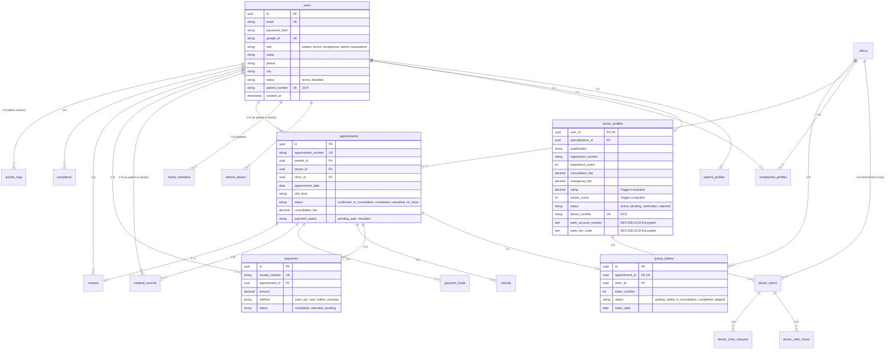

# BookMyDoctor24 — Database, Data Modeling & Storage Architecture

This document provides the definitive architectural specification for database schemas, entity relationships, database triggers, indexing strategies, Redis keyspaces, and file storage in **BookMyDoctor24**.

---

## 💾 Core Persistence Technology Stack

- **Relational Database:** PostgreSQL 16
- **Object-Relational Mapping (ORM):** Prisma (`server/server/prisma/schema.prisma`)
- **Primary Keys:** UUID v4 strings (`@id @default(uuid())`) across all relational tables
- **Naming Conventions:**
  - Database Table & Column Names: `snake_case` (e.g., `doctor_id`, `created_at`)
  - Application Domain Model Fields: `camelCase` (e.g., `doctorId`, `createdAt`) mapped via `@map`
- **In-Memory Store:** Redis 7 (Cache-aside, distributed mutex locks, BullMQ queue, ephemeral OTPs)
- **File System / Media Storage:** Local file system with S3-compatible path abstractions

---

## 🗺️ Entity-Relationship Diagram (ERD)



---

## 🏛️ Schema Architecture & Core Tables

### 1. Identity & Profile Tables
- **`users`:** Central identity registry. Stores authentication credentials, OAuth identifiers, contact info, and system-wide account status (`active` or `disabled`).
- **`patient_profiles`:** 1:1 extension of `users` for patients. Stores demographic data (`date_of_birth`, `gender`, `blood_group`), `emergency_contact`, and medical history summaries.
- **`doctor_profiles`:** 1:1 extension of `users` for doctors. Contains clinical qualifications, medical registration number, experience years, consultation fees, live rating/review counters, and AES-256-GCM encrypted bank payout credentials.
- **`receptionist_profiles`:** 1:1 extension linking receptionists to their assigned `clinic_id`.
- **`refresh_tokens`:** Hashed storage of active JWT refresh tokens. Rotated single-use tokens automatically cascade-delete when the owning user is removed.

### 2. Clinic & Scheduling Tables
- **`clinics`:** Clinic entities including geographic coordinates, full address, contact numbers, and approval status (`active`, `pending_approval`, `rejected`).
- **`doctor_clinics`:** N:M junction linking doctors to clinics. Controls doctor status at specific facilities (`active`, `inactive`).
- **`doctor_clinic_hours`:** Weekly recurring OPD consultation schedules by day of week (`0` = Sunday through `6` = Saturday), start time, end time, and maximum token capacity.
- **`doctor_clinic_closures`:** Specific calendar date ranges when OPD is closed (e.g. physician vacations or clinic maintenance).

### 3. Consultation & Clinical Tables
- **`appointments`:** The core operational table. Tracks patient, doctor, clinic, slot date/time, consultation status, and financial state.
- **`queue_tokens`:** Tracks the physical OPD token number (`token_number`) and live progression (`waiting` $\rightarrow$ `called` $\rightarrow$ `in_consultation` $\rightarrow$ `completed`).
- **`medical_records`:** Electronic Medical Record (EMR) entries created exclusively by doctors. Stores symptoms, clinical diagnosis, JSON-structured medication prescriptions, and recommended lab tests.

### 4. Financial & Payment Tables
- **`payments`:** Financial transaction ledger. Maps receipts to appointments with method breakdown (`cash`, `upi`, `card`, `online_razorpay`).
- **`refunds`:** Tracks refund requests, approval status, gateway refund identifiers, and failure retry counters.
- **`payment_holds`:** Ephemeral holds placed during checkout to guarantee slot reservation pending payment gateway confirmation.
- **`platform_charges`:** Singleton configuration tracking platform service fees and tax percentages.

---

## ⚡ Database Constraints, Triggers & Sequences

### 1. Double-Booking Prevention (Partial Unique Index)
To prevent race conditions where two patients reserve the same doctor slot simultaneously, PostgreSQL enforces a partial unique index:
```sql
CREATE UNIQUE INDEX idx_unique_active_slot
ON appointments (doctor_id, appointment_date, slot_time)
WHERE status NOT IN ('cancelled', 'rejected');
```
*Why partial?* If an appointment is cancelled, that specific `(doctor_id, appointment_date, slot_time)` immediately becomes available for re-booking without violating database constraints.

### 2. Doctor Rating Recomputation Trigger
Instead of computing doctor ratings in application code, a PostgreSQL trigger automatically recalculates `rating` and `review_count` whenever a review status becomes `approved`:
```sql
CREATE OR REPLACE FUNCTION recompute_doctor_rating()
RETURNS TRIGGER AS $$
BEGIN
    UPDATE doctor_profiles
    SET
        rating = COALESCE((
            SELECT ROUND(AVG(rating)::numeric, 1)
            FROM reviews
            WHERE doctor_id = COALESCE(NEW.doctor_id, OLD.doctor_id)
              AND status = 'approved'
        ), 0.0),
        review_count = (
            SELECT COUNT(*)
            FROM reviews
            WHERE doctor_id = COALESCE(NEW.doctor_id, OLD.doctor_id)
              AND status = 'approved'
        )
    WHERE user_id = COALESCE(NEW.doctor_id, OLD.doctor_id);
    RETURN NEW;
END;
$$ LANGUAGE plpgsql;

CREATE TRIGGER trg_recompute_doctor_rating
AFTER INSERT OR UPDATE OR DELETE ON reviews
FOR EACH ROW EXECUTE FUNCTION recompute_doctor_rating();
```

### 3. Sequence Identifiers
Human-friendly sequences are managed via dedicated PostgreSQL sequences:
- `patient_number_seq`: Generates unique patient numbers prefixed with `DCP` (e.g. `DCP1001`).
- `doctor_number_seq`: Generates doctor IDs prefixed with `DCD` (e.g. `DCD1001`).
- `appointment_number_seq`: Formatted as `B<YYMMDD>-<SEQ>`.
- `payment_receipt_seq`: Formatted as `REC-<YYMM>-<SEQ>`.

### 4. Singleton Constraint Enforcement
System-wide configuration tables (`system_settings` and `booking_rules`) must contain exactly one row:
```sql
ALTER TABLE system_settings ADD CONSTRAINT chk_singleton_system_settings CHECK (id = 1);
ALTER TABLE booking_rules ADD CONSTRAINT chk_singleton_booking_rules CHECK (id = 1);
```

---

## 🔍 Indexing & Query Optimization

To maintain sub-20ms query response times under high load, the following indices are maintained:

1. **Trigram Fuzzy Search (`pg_trgm`):**
   ```sql
   CREATE EXTENSION IF NOT EXISTS pg_trgm;
   CREATE INDEX idx_trgm_users_name ON users USING gin (name gin_trgm_ops);
   CREATE INDEX idx_trgm_clinics_name ON clinics USING gin (name gin_trgm_ops);
   CREATE INDEX idx_trgm_doctor_qualification ON doctor_profiles USING gin (qualification gin_trgm_ops);
   ```
   Enables fast wildcard and typo-tolerant search across patient and doctor discovery queries.

2. **High-Frequency Compound Query Indices:**
   - `appointments(doctor_id, appointment_date, status)`
   - `appointments(patient_id, created_at DESC)`
   - `queue_tokens(clinic_id, token_date, status)`
   - `payments(appointment_id, status)`

---

## ⚡ Redis In-Memory Keyspace & Data Structures

Redis is used for caching, distributed locking, background queues, and ephemeral state:

```text
Redis Keyspace
├── cache:                      # Cache-aside cached JSON payloads
│   ├── doctors:list:*          # Public directory listings (TTL: 60s)
│   ├── queue:live:<clinicId>   # Live clinic queue tokens (TTL: 10s)
│   └── appointments:list:*     # Role-scoped appointment views (TTL: 30s)
│
├── lock:                       # Distributed mutex locks (TTL: 10s lease)
│   └── slot:<docId>:<date>:<slot>
│
├── otp:                        # Ephemeral registration verification codes
│   └── register:<email>        # 6-digit OTP code (TTL: 300s / 5 minutes)
│
├── rl:                         # Distributed rate limiting counters
│   ├── auth:<ip>               # 15-minute sliding window counters
│   └── user:<userId>           # User-keyed booking/payment counters
│
└── bull:booking-queue:*        # BullMQ Redis Streams, Sorted Sets & Hashes
```

---

## 📂 File Storage Hierarchy

Files are stored locally (with S3-compatible path mapping in production) under `server/server/uploads/`:

```text
uploads/
├── photos/                     # Public user avatars & profile photos
│   └── <uuid>.webp             # Max 5MB, converted/stored via Multer
│
├── qr/                         # Public clinic payment UPI QR codes
│   └── <uuid>.png              # Served directly via express.static('/uploads')
│
└── documents/                  # PRIVATE Doctor KYC & Registration Documents
    └── <uuid>.pdf              # Max 10MB, restricted access via HMAC signed tokens
```
