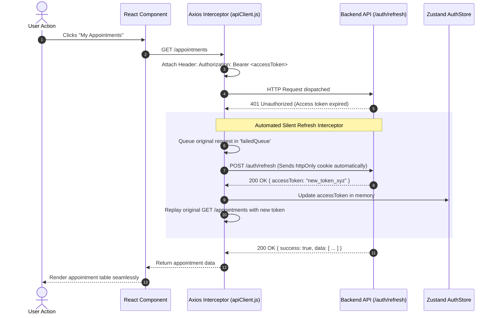

# BookMyDoctor24 — Web Frontend Architecture

This document details the frontend architecture, state management, routing guards, component design system, and API integration for the **BookMyDoctor24 Web Client** (located under `client/`).

---

## 🎨 Technology Stack & Overview

The web client is a high-performance Single Page Application (SPA) built for doctors, patients, receptionists, and system administrators.

- **Core Library:** React 19 (`react`, `react-dom`)
- **Build Tool & Dev Server:** Vite 8 (Ultra-fast Hot Module Replacement)
- **Routing:** React Router v6 (`react-router-dom`)
- **State Management:** Zustand v5 (Minimalist, decoupled store architecture)
- **HTTP Client:** Axios v1.8 (Configured with automated silent token refresh queue)
- **Styling:** Tailwind CSS v3 + Custom responsive tokens (`index.css`, `reference_site.css`, `responsive.css`)
- **Data Visualization:** Chart.js v4 + `react-chartjs-2` (Admin metrics and revenue trends)
- **Code Quality:** Oxlint (High-speed Rust-based linter) + Vitest with React Testing Library

---

## 📂 Source Code Structure (`client/src/`)

```text
client/src/
├── components/                 # Reusable UI primitives
│   ├── Header.jsx              # Global header with role badges & profile dropdown
│   ├── Sidebar.jsx             # Role-aware responsive navigation drawer
│   ├── Modal.jsx               # Accessible dialog overlays
│   ├── Toast.jsx               # Non-blocking notification toasts
│   └── StatusBadge.jsx         # Visual pills for appointment & payment statuses
│
├── hooks/                      # Custom React hooks
│   ├── useAuth.js              # Shortcut to auth state and login/logout methods
│   ├── useDebounce.js          # Input debouncing for doctor/clinic directory search
│   └── useNotifications.js     # Polling and badge counts for in-app notifications
│
├── layouts/                    # Role-specific scaffolds
│   ├── PublicLayout.jsx        # Landing page layout with public header & footer
│   ├── PatientLayout.jsx       # Patient dashboard with quick booking shortcuts
│   ├── StaffLayout.jsx         # Clinical layout for Doctors and Receptionists
│   └── AdminLayout.jsx         # Operational layout with admin metrics navigation
│
├── lib/                        # Cross-cutting utilities & API client
│   ├── apiClient.js            # Central Axios instance with refresh interceptors
│   ├── csv.js                  # Client-side CSV generation & download engine
│   ├── dateUtils.js            # Business timezone (Asia/Kolkata) date formatters
│   └── razorpay.js             # Dynamic script loader & checkout options builder
│
├── pages/                      # View components organized by domain
│   ├── PublicLanding.jsx       # Hero, feature highlights, and doctor search
│   ├── PublicPages.jsx         # Doctor directory, clinic directory, contact form
│   ├── PatientPages.jsx        # Bookings, queue tracker, EMR records, family profiles
│   ├── StaffPages.jsx          # Doctor OPD call screen, receptionist desk, payments
│   ├── AdminPages.jsx          # Approvals, system settings, activity logs, stats
│   ├── FeaturePages.jsx        # Emergency booking, online consultation
│   ├── TermsOfService.jsx      # Legal Terms of Service
│   └── PrivacyPolicy.jsx       # Patient privacy and data protection terms
│
├── store/                      # Zustand state stores
│   ├── useAuthStore.js         # User identity, roles, access token, and login state
│   └── useNotificationStore.js # Unread notification alerts
│
├── App.jsx                     # Root router, role guards, and route configuration
├── main.jsx                    # React 19 bootstrap & mount point
└── index.css                   # Global styles and typography (Inter)
```

---

## 🔐 Client Authentication & Silent Token Refresh

The web client maintains access tokens in-memory while persisting refresh tokens in an `httpOnly`, `SameSite=Lax` cookie. This safeguards sessions from XSS token theft while preserving seamless session continuity.



### Axios Interceptor Implementation Highlights (`src/lib/apiClient.js`):
1. **Concurrent Request De-duplication:** If multiple components request data simultaneously when the token expires, only **one** `/auth/refresh` request is dispatched. All other outgoing requests wait in a Promise queue (`failedQueue`) and replay automatically upon resolution.
2. **Session Termination Handling:** If `/auth/refresh` returns `401` or `403` (e.g. token expired or session revoked), the queue rejects, the store clears user state, and the router redirects to `/login?session_expired=true`.

---

## 🛡️ Role-Based Route Guards (`App.jsx`)

Routes are wrapped in a declarative `<ProtectedRoute>` component that verifies both authentication and role entitlements:

```jsx
<Route
  path="/staff/queue"
  element={
    <ProtectedRoute allowedRoles={['doctor', 'receptionist']}>
      <StaffPages.QueueManagement />
    </ProtectedRoute>
  }
/>
```

### Route Guard Behavior:
- **Unauthenticated Visitors:** Automatically redirected to `/login` with a `returnUrl` query parameter, enabling post-login return to the target page.
- **Role Mismatch:** If an authenticated Patient attempts to access `/admin/settings`, they are gracefully redirected to `/unauthorized` with an informative message.
- **Disabled Accounts:** If the backend responds with `ACCOUNT_DISABLED`, the user is immediately logged out and shown an account suspension notification.

---

## 🧭 Key Feature Workflows

### 1. Doctor Discovery & Appointment Booking Flow
1. **Fuzzy Directory Search:** `PublicPages.jsx` uses `useDebounce` (300ms) to query `/doctors` by specialization, city, or name.
2. **Interactive Schedule Selector:** Once a doctor is selected, the patient views active clinic affiliations and available OPD time slots calculated from `doctor_clinic_hours` and `doctor_clinic_closures`.
3. **Waiting-Room Enqueue:** Submitting the booking sends `POST /appointments`, receiving a `jobId`. A modal opens showing an animated waiting room status while polling `/appointments/booking-status/:jobId`.
4. **Instant Confirmation:** Upon BullMQ job completion, the appointment confirmation is displayed with the allocated Token Number and QR code.

### 2. Live OPD Queue Tracker (`PatientPages.jsx`)
- Patients can track their in-person OPD consultation queue position remotely.
- The screen polls `GET /queue/mine/:appointmentId` every 15 seconds.
- Displays:
  - **Your Token:** e.g., `#14`
  - **Current Token Called:** e.g., `#9`
  - **Patients Ahead:** `5`
  - **Estimated Wait Time:** Calculated dynamically based on the doctor's average consultation duration.

### 3. Razorpay Web Checkout Integration (`lib/razorpay.js`)
- Triggers upon clicking "Pay Advance" or "Pay Consultation Fee".
- Initializes an order via `POST /payments/razorpay/order`.
- Dynamically loads `https://checkout.razorpay.com/v1/checkout.js`.
- Configures options with the user's name, email, and brand theme (`#D9534F`).
- Upon success, posts verification data to `POST /payments/razorpay/verify`, instantly unlocking receipts and confirmation cards.

### 4. Client-Side Data Export (`lib/csv.js`)
- Provides CSV exports for Doctors, Receptionists, and Admins without burdening server CPU.
- Formats date strings to business timezone (`Asia/Kolkata`).
- Automatically handles RFC 4180 escaping (commas, quotes, newlines) and generates a downloadable file directly in the browser via Blob URLs.

---

## 🎭 UI Design System & Component Guidelines

The interface adheres to a modern, clinical, trustworthy aesthetic:

### Color Palette:
- **Primary Brand:** Deep Terracotta / Crimson (`#C93B2B`, `#D9534F`) — reflects vitality and urgency.
- **Secondary Accent:** Medical Teal / Cyan (`#0D9488`, `#14B8A6`) — represents calm and clinical precision.
- **Neutral Grays:** Slate palette (`#0F172A` to `#F8FAFC`) — optimized for high contrast and readability.
- **Functional Semantics:**
  - `Confirmed / Completed / Paid:` Emerald Green (`#059669`)
  - `In Consultation / Active:` Blue (`#2563EB`)
  - `Waiting / Pending Payment:` Amber (`#D97706`)
  - `Cancelled / No Show:` Rose Red (`#E11D48`)

### Typography:
- **Primary Typeface:** **Inter** (`Inter, -apple-system, BlinkMacSystemFont, "Segoe UI", Roboto, sans-serif`).
- Clear hierarchy: Page titles (`text-2xl font-bold tracking-tight`), card headers (`text-lg font-semibold`), data tables (`text-sm font-medium`).

---

## 🧪 Testing & Quality Assurance

```bash
cd client
npm run lint         # Runs Oxlint across all JSX files
npm run test         # Executes Vitest test suites
npm run test:watch   # Interactive Vitest test runner
```

### Test Coverage Highlights:
- **Component Tests:** Validates UI rendering, form submission, and error alerts (`PatientPages.test.jsx`, `AdminPages.test.jsx`, `StaffPages.test.jsx`).
- **Integration Tests:** `integration/login-flow.test.jsx` tests the end-to-end login, token storage, and role redirection sequence.
