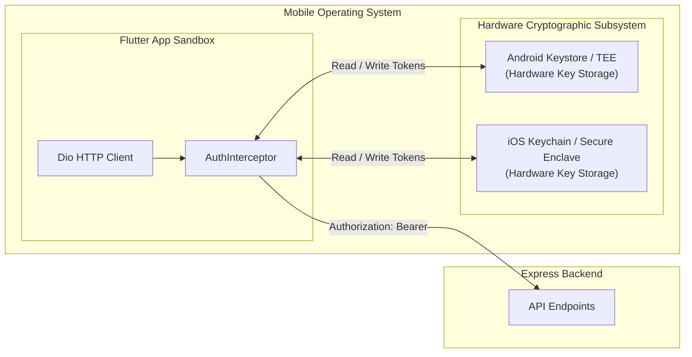

# BookMyDoctor24 — Mobile App Architecture (Flutter)

This document describes the mobile engineering architecture, native hardware integration, state management, and offline resilience for the **BookMyDoctor24 Flutter Mobile App** (located under `mobile/`).

---

## 📱 Mobile Platform Overview

The mobile application is a cross-platform client for **Android** and **iOS**, achieving 100% feature parity with the web application across all 4 user roles (**Patient**, **Doctor**, **Receptionist**, **Admin**).

### Technology Stack & Dependencies:
- **Framework:** Flutter (Dart SDK `>=3.3.0 <4.0.0`)
- **Networking:** `dio` v5.4 (Advanced HTTP client with custom interceptor chains)
- **State Management:** `provider` v6.1 (Clean, reactive state architecture)
- **Hardware Secure Storage:** `flutter_secure_storage` v9.2 (Android Keystore & iOS Keychain)
- **Payments:** `razorpay_flutter` v1.3 (Native payment gateway sheet)
- **Authentication:** `google_sign_in` v6.2 (Native Google Account Picker)
- **Crash Reporting:** `sentry_flutter` v9.0 (Native error tracking & ANR detection)
- **Connectivity:** `connectivity_plus` v6.0 (Live internet connection monitoring)
- **Media & File Handling:** `image_picker` v1.2, `http_parser` v4.0 (Camera & gallery uploads)
- **Native Device Actions:** `url_launcher` v6.3 (Phone dialer), `share_plus` v10.1 (Native share & CSV exports)
- **Design & Typography:** `google_fonts` v6.2 (**Inter** typeface for exact visual brand consistency with web)

---

## 📂 Source Code Layout (`mobile/lib/`)

```text
mobile/lib/
├── config/                     # Environment configuration & constants
│   ├── api_config.dart         # Base URL discovery (Emulator vs Device Wi-Fi)
│   └── google_auth_config.dart # Google OAuth Web Client ID & scopes
│
├── core/                       # Networking & cross-cutting infrastructure
│   ├── api_client.dart         # Configured Dio instance with multipart helpers
│   ├── auth_interceptor.dart   # Automatic Bearer injection & 401 token refresh queue
│   ├── csv_export.dart         # RFC 4180 CSV builder & native text sharing
│   └── exceptions.dart         # Typed application & network exceptions
│
├── models/                     # Strongly typed Dart domain models
│   ├── user.dart               # User identity & role enum
│   ├── appointment.dart        # Appointment model with status enums
│   ├── queue_token.dart        # Live token model
│   ├── doctor.dart             # Doctor profile, specialization, and clinic OPD slots
│   └── clinic.dart             # Clinic location, contact, and hours
│
├── routing/                    # Navigation & route guards
│   ├── app_router.dart         # Declarative named routes
│   └── route_guard.dart        # Role-based screen access gates
│
├── screens/                    # User interface views by role
│   ├── auth/                   # Login, Register, Forgot Password, OTP entry
│   ├── patient/                # Dashboard, Doctor Search, Booking, Live Queue, EMR
│   ├── doctor/                 # OPD Calling Screen, Consultations, Prescription Writer
│   ├── receptionist/           # Front Desk, Walk-in Token Registration, Cash Billing
│   ├── admin/                  # Dashboard Analytics, Approvals, System Settings
│   └── shared/                 # Profile, Terms, Privacy Policy
│
├── state/                      # Provider state managers
│   ├── auth_provider.dart      # User session, login, registration, and logout
│   ├── appointment_provider.dart# Booking state, queue waiting room polling
│   └── queue_provider.dart     # Live token tracking for doctors & patients
│
├── theme/                      # Styling & Design System
│   └── app_theme.dart          # Inter typography, Material 3 theme, Terracotta/Teal palette
│
├── widgets/                    # Reusable UI components
│   ├── connectivity_banner.dart# Top banner displayed when network drops
│   ├── role_scaffold.dart      # Scaffold with role-tailored drawer & bottom nav
│   └── status_pill.dart        # Visual badge for appointment & payment statuses
│
└── main.dart                   # Application entry point with Sentry error boundary
```

---

## 🔒 Mobile Security & Secure Token Storage

Unlike web browsers that use `httpOnly` cookies, mobile applications store authentication credentials in hardware-backed storage:



### 1. Hardware-Backed Encryption (`flutter_secure_storage`)
- **Android:** Uses Android Keystore provider with AES encryption and RSA key wrapping inside the device Trusted Execution Environment (TEE).
- **iOS:** Stores credentials inside iOS Keychain protected by the Secure Enclave hardware chip.
- Keys stored:
  - `access_token`: Short-lived JWT (15 minutes).
  - `refresh_token`: Long-lived cryptographic token (30 days).
  - `current_user`: Cached JSON profile of the authenticated user.

### 2. Native Silent Token Refresh (`AuthInterceptor`)
When the API returns `401 Unauthorized`:
1. `AuthInterceptor` intercepts the error response.
2. Checks if another refresh is already in-flight (using a Dart `Completer` lock).
3. Dispatches a standalone `POST /auth/refresh` passing the stored `refresh_token`.
4. Saves newly minted tokens to `flutter_secure_storage`.
5. Updates the original request's `Authorization` header with the new access token and retries the request seamlessly.
6. If the refresh fails (e.g. session revoked), clears storage and dispatches an unauthenticated notification to `AuthProvider`, steering the user to `LoginScreen`.

---

## 🌐 Network Discovery & Local Dev Connectivity (`api_config.dart`)

Connecting a mobile app to a local development backend requires distinct URL handling depending on the execution target:

| Environment | Host IP | Configuration in `api_config.dart` |
|---|---|---|
| **Android Emulator** | `10.0.2.2:4000` | Points to host machine's `localhost:4000` |
| **iOS Simulator** | `localhost:4000` | Shares localhost networking directly with macOS |
| **Physical Device (Wi-Fi)**| `192.168.x.x:4000`| Machine's local network LAN IP address |
| **Staging / Production** | `https://api.bookmydoctor.com` | Deployed domain |

`api_config.dart` dynamically detects the runtime platform (Android vs iOS) and selects the appropriate default host, with an override option via `--dart-define=API_URL=...`.

---

## 📶 Offline Resilience & Connectivity Banner

Healthcare workflows frequently operate in areas with intermittent hospital or clinic network coverage:

```dart
// connectivity_banner.dart
Consumer<ConnectivityProvider>(
  builder: (context, connectivity, child) {
    if (!connectivity.isOnline) {
      return Container(
        color: AppColors.errorRed,
        padding: const EdgeInsets.symmetric(vertical: 4),
        child: const Center(
          child: Text(
            'No internet connection. Waiting for network...',
            style: TextStyle(color: Colors.white, fontSize: 12),
          ),
        ),
      );
    }
    return const SizedBox.shrink();
  },
)
```

- Mounted at the root of `RoleScaffold`.
- Real-time stream subscription to `Connectivity().onConnectivityChanged`.
- The banner appears instantly when network disconnects and auto-dismisses upon reconnection.

---

## 💳 Native Features & Hardware Integration

### 1. Razorpay Native Mobile Checkout (`razorpay_flutter`)
- When a patient confirms a booking requiring an advance consultation fee, `PaymentRequiredScreen` triggers the native Razorpay SDK.
- Launches native Android Activity / iOS UIViewController with UPI Intent support (Google Pay, PhonePe, Paytm).
- Callbacks (`handlePaymentSuccess`, `handlePaymentError`, `handleExternalWallet`) verify signatures via `POST /payments/razorpay/verify`.

### 2. Direct Emergency Call Dialer (`url_launcher`)
- On `EmergencyBookingScreen`, clicking "Call Clinic Desk" executes:
  ```dart
  final uri = Uri.parse('tel:$clinicPhone');
  if (await canLaunchUrl(uri)) {
    await launchUrl(uri);
  }
  ```
- Opens the native device dialer with the clinic's phone number pre-filled.

### 3. File & Document Uploads (`image_picker`)
- Supports taking live camera photos or selecting PDFs/images from the device photo gallery for doctor KYC verification and clinic UPI QR codes.
- Streams files to backend via `core/api_client.dart#uploadFile` using Dio `FormData` and `MultipartFile`.

### 4. Native CSV Export & Sharing (`share_plus`)
- Doctor OPD reports, payment receipts, and receptionist token registries can be exported directly from mobile.
- Formats tabular data via `core/csv_export.dart` and triggers the OS native share sheet (`Share.share(csvContent, subject: 'opd_report.csv')`).

---

## 🎨 Theme & Typography

- **Font:** Google Fonts **Inter** (`GoogleFonts.interTextTheme()`).
- **Brand Colors:**
  - Terracotta Primary: `Color(0xFFC93B2B)`
  - Medical Teal Accent: `Color(0xFF0D9488)`
  - Surface Slate: `Color(0xFFF8FAFC)`
  - Border Gray: `Color(0xFFE2E8F0)`
- Adheres to Material 3 guidelines with edge-to-edge system bar styling.

---

## 🧪 Testing & Validation

```bash
cd mobile
flutter test                                      # Runs all unit & widget tests
flutter test test/widgets/login_screen_test.dart  # Runs specific widget tests
flutter test integration_test/app_test.dart       # Runs integration tests
```
