# BookMyDoctor24 — Master Documentation Portal

Welcome to the comprehensive technical documentation for **BookMyDoctor24** (also known as *BookADoctors*), an enterprise-grade, multi-tenant healthcare appointment booking, clinic OPD queue management, and Electronic Medical Records (EMR) platform.

---

## 📚 Documentation Navigation Map

Every tier and aspect of the platform is extensively documented below. Select the appropriate guide based on your domain:

| Document | Purpose & Scope | Target Audience |
|---|---|---|
| [🔒 Security Architecture](./SECURITY_ARCHITECTURE.md) | Auth lifecycle (JWT/Refresh), RBAC, AES-256-GCM encryption, OWASP Top 10, Rate limiting, Webhook HMAC, Audit records | Security Engineers, DevSecOps, Backend Devs |
| [📡 REST API Reference](./API_DOCUMENTATION.md) | Complete catalog of 20 modules, 80+ endpoints, schemas, cURL examples, error codes, and pagination | Frontend/Mobile Developers, API Consumers |
| [⚙️ Backend Architecture](./BACKEND_ARCHITECTURE.md) | Node.js/Express modular design, Prisma ORM, BullMQ queue worker, Redis caching/locks, concurrency tuning | Backend Engineers, System Architects |
| [💻 Frontend Architecture](./FRONTEND_ARCHITECTURE.md) | React 19, Vite, Zustand state, Axios interceptors, dynamic theming, component hierarchy, responsive layouts | Web Engineers, UI/UX Developers |
| [📱 Mobile App Architecture](./MOBILE_APP_ARCHITECTURE.md) | Flutter cross-platform architecture, Dio networking, Provider state, hardware secure storage, Razorpay mobile SDK | Mobile Engineers (Android/iOS) |
| [🗄️ Database & Storage Architecture](./DATABASE_AND_STORAGE.md) | PostgreSQL schema deep-dive, Prisma models, constraints/triggers, Trigram indexing, Redis cache keys, file hierarchy | Database Administrators, Backend Engineers |
| [🚀 Deployment & DevOps Guide](./DEPLOYMENT_AND_DEVOPS.md) | Docker Compose, multi-replica Nginx load balancing, environment configuration reference, CI/CD, migration workflows | DevOps, SREs, Cloud Engineers |
| [🧪 Testing & QA Guide](./TESTING_AND_QA.md) | Backend Jest suites, Vitest web tests, Flutter widget/integration tests, Playwright E2E, k6 load testing | QA Engineers, Test Automation Engineers |

---

## 🏛️ High-Level System Architecture

BookMyDoctor24 connects **Patients**, **Doctors**, **Receptionists**, and **Administrators** through a unified backend architecture. Both the React Web Client and the Flutter Mobile App consume the exact same authenticated REST API.

```mermaid
flowchart TB
    subgraph Clients["Frontend Clients"]
        WebClient["React 19 Web SPA<br/>(Vite + Tailwind + Zustand)"]
        MobileClient["Flutter Mobile App<br/>(Android / iOS)"]
    end

    subgraph Gateway["Reverse Proxy & Gateway"]
        Nginx["Nginx Reverse Proxy / Load Balancer<br/>(Port 4000)"]
    end

    subgraph BackendCluster["Backend API Services (Node.js 18+)"]
        API1["Express API Instance 1"]
        API2["Express API Instance 2"]
        APIN["Express API Instance N"]
        Worker["BullMQ Booking Worker<br/>(Separate Process)"]
    end

    subgraph DataTier["Data & State Persistence"]
        Postgres[("PostgreSQL 16 Database<br/>(Prisma ORM + Trigram Search)")]
        RedisStore[("Redis 7 In-Memory Store<br/>(BullMQ + Cache-Aside + Distributed Locks)")]
        LocalMedia[("Media Storage<br/>(Profile Photos, Pre-signed Documents)")]
    end

    subgraph ThirdParty["External Providers & Integrations"]
        Razorpay["Razorpay Payment Gateway<br/>(Orders, Verification, Webhooks)"]
        GoogleOAuth["Google Identity Services<br/>(OAuth 2.0 / OpenID Connect)"]
        NotificationProviders["SMS / Email Providers<br/>(Fast2SMS / Twilio / SMTP / SES)"]
        Sentry["Sentry Error Tracking<br/>(Crash Reporting & Performance)"]
    end

    WebClient -->|HTTP/REST /api-docs| Nginx
    MobileClient -->|HTTP/REST / Bearer Token| Nginx
    Nginx -->|Upstream Round-Robin| API1
    Nginx -->|Upstream Round-Robin| API2
    Nginx -->|Upstream Round-Robin| APIN

    API1 & API2 & APIN -->|SQL Queries & Transactions| Postgres
    API1 & API2 & APIN -->|Cache / Locks / Jobs| RedisStore
    API1 & API2 & APIN -->|Local/S3 File Operations| LocalMedia
    Worker -->|Process Booking Queues| RedisStore
    Worker -->|Finalize Appointments| Postgres

    API1 & API2 & APIN -->|Create Orders & Verify| Razorpay
    Razorpay -->|HMAC Webhook Postback| Nginx
    API1 & API2 & APIN -->|Verify ID Tokens| GoogleOAuth
    API1 & API2 & APIN -->|Send OTP / Alerts| NotificationProviders
    API1 & API2 & APIN & MobileClient -->|Capture Exceptions| Sentry
```



---

## 👥 Platform User Roles & Access Hierarchy

The system defines 5 strict roles in an authenticated hierarchy:

```text
[Superadmin]  👑 Unrestricted system access, platform fees, global audit logs, account terminations
      │
   [Admin]    🛡️ Doctor & clinic approvals, complaints resolution, system booking rules
      │
  [Doctor]    🩺 OPD schedule control, token call & consultation, EMR prescriptions, payout settings
      │
[Receptionist]📋 Clinic queue management, walk-in token generation, on-premise payment collection
      │
  [Patient]   👤 Doctor discovery, appointments, online advance payments, family member profiles
```

---

## 📂 Repository Organization

```text
bookMyDoctor/
├── client/                     # Web Single Page Application (React 19 + Vite)
│   ├── src/
│   │   ├── components/         # Shared UI components (Sidebar, Header, Dialogs)
│   │   ├── hooks/              # Custom React hooks (auth, debounce, notifications)
│   │   ├── layouts/            # Role-specific layouts & navigation scaffolds
│   │   ├── lib/                # API Client (Axios interceptors), date utils, CSV export
│   │   ├── pages/              # Role pages: Patient, Staff, Admin, Feature, Public
│   │   └── store/              # Zustand global state stores (useAuthStore, etc.)
│   └── package.json
│
├── mobile/                     # Cross-platform Mobile Application (Flutter)
│   ├── lib/
│   │   ├── config/             # Environment endpoints and Google client IDs
│   │   ├── core/               # Dio networking, token storage, exceptions, CSV exporter
│   │   ├── models/             # Strongly typed Dart data models
│   │   ├── routing/            # Role-based route definitions and navigation guards
│   │   ├── screens/            # Screens for Patient, Doctor, Receptionist, Admin, Guest
│   │   ├── state/              # Provider state holders (AuthProvider, AppointmentProvider)
│   │   ├── theme/              # Typography (Inter), color schemes, input styling
│   │   └── widgets/            # Reusable UI widgets, connectivity banner, role scaffold
│   └── pubspec.yaml
│
├── server/server/              # Backend API & Worker Engine (Node.js + Express)
│   ├── prisma/
│   │   ├── schema.prisma       # Comprehensive Prisma data model (25+ tables)
│   │   └── migrations/         # Sequential database migrations (including baseline)
│   ├── src/
│   │   ├── config/             # Database (Prisma), Redis, Winston logger, Sentry, Swagger
│   │   ├── jobs/               # BullMQ booking queue & asynchronous worker process
│   │   ├── middleware/         # Auth, RBAC, Rate limiters, InFlightGuard, Error handler
│   │   ├── modules/            # 20 modular business domains (controller-service pattern)
│   │   │   ├── admin/          # System metrics, audit trail, patient management
│   │   │   ├── appointments/   # Booking enqueue, status lifecycle, slot calculation
│   │   │   ├── auth/           # Login, registration, OTPs, JWT rotation, Google OAuth
│   │   │   ├── clinics/        # OPD hours, temporary closures, doctor assignments
│   │   │   ├── doctors/        # Profiles, specialization, KYC docs, bank payout details
│   │   │   ├── payments/       # Ledger, Razorpay order/verify/webhook, refunds
│   │   │   ├── queue/          # Live OPD token tracker, queue progression state
│   │   │   └── ...             # medicalRecords, reviews, notifications, etc.
│   │   ├── routes/             # Unified central routing registry
│   │   ├── services/           # Cache-aside, distributed locks, crypto encryption, uploads
│   │   └── utils/              # Standard JSON envelopes, ApiError, asyncHandler
│   └── package.json
│
├── docs/                       # Technical Documentation Suite (You are here)
├── nginx/                      # Nginx reverse proxy configuration for API load balancing
├── docker-compose.yml          # Local and staging multi-container orchestration
├── deploy.sh                   # Automated deployment script
└── README.md                   # Repository landing README
```

---

## ⚡ Quick Start Reference

### 1. Backend Service (`server/server/`)
```bash
cd server/server
npm install
cp .env.example .env
# Edit .env with PostgreSQL & Redis credentials, and generate JWT secrets
npx prisma migrate deploy
npm run seed       # Seeds demo accounts (patient, doctor, receptionist, admin, superadmin)

# In Terminal 1 (API Server):
npm run dev

# In Terminal 2 (BullMQ Worker - Required for appointment bookings):
npm run worker
```

### 2. Web Client (`client/`)
```bash
cd client
npm install
npm run dev
# Accessible at http://localhost:5173 (Connected to http://localhost:4000)
```

### 3. Mobile Application (`mobile/`)
```bash
cd mobile
flutter pub get
flutter run
# Select Android emulator, iOS simulator, or connected device
```

### 4. Full Stack via Docker Compose
```bash
docker compose up --build
```

---

## 🔐 Demo Credentials (Seeded Accounts)

| Role | Email | Password | Permissions |
|---|---|---|---|
| **Superadmin** | `superadmin@connectdoctor.test` | `Super#DC2026!Test` | Full root access, fee configuration, system override |
| **Admin** | `admin@connectdoctor.test` | `Admin#DC2026!Test` | Doctor verification, clinic approvals, dispute handling |
| **Doctor** | `doctor@connectdoctor.test` | `Doctor#DC2026!Test` | OPD schedules, patient consultation, EMR write |
| **Receptionist**| `receptionist@connectdoctor.test`| `Reception#DC2026!Test` | Desk tokens, walk-in registration, cash billing |
| **Patient** | `patient@connectdoctor.test` | `Patient#DC2026!Test` | Doctor booking, queue monitoring, record viewing |

---

*Continue reading the specialized documentation in the table above for detailed specifications.*
