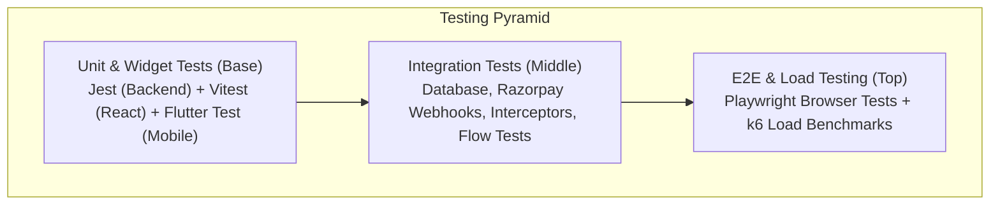

# BookMyDoctor24 — Testing Strategy & Quality Assurance Guide

This document defines the comprehensive testing methodology, automation frameworks, test suites, and load testing benchmarks across the backend, web client, and mobile applications of **BookMyDoctor24**.

---

## 🧪 Testing Pyramid & Quality Gates

The quality assurance strategy enforces rigorous testing across all tiers:



---

## 1. ⚙️ Backend Test Automation (`server/server/`)

Backend test suites run via **Jest** with environment-isolated mock configurations:

### Command Reference:
```bash
cd server/server
npm run test           # Executes all unit and module tests
npm run test:watch     # Interactive watch mode
npm run test:coverage  # Generates code coverage report
```

### Dedicated Integration & Concurrency Audits:
The repository includes dedicated integration test suites verifying complex financial and concurrency guarantees against live or mock databases:

1. **Fintech Reconciliation Audit (`test_fintech_reconciliation_complete.js`):**
   - Tests `POST /payments/webhook/razorpay` signature validation (`crypto.timingSafeEqual`).
   - Verifies that dropped client verify calls are reconciled idempotently without double-crediting appointments.
2. **Multi-Doctor Production Audit (`test_multi_doctor_production_audit.js`):**
   - Simulates 50 concurrent booking attempts for conflicting doctor slots.
   - Verifies that PostgreSQL partial unique constraints and Redis distributed locks eliminate double-bookings.
3. **Payment Hold Reservation Audit (`test_payment_hold_reservation_audit.js`):**
   - Tests slot reservation timeout expirations and automatic inventory release when a patient abandons checkout.

---

## 2. 💻 Web Client Test Automation (`client/`)

The web client uses **Vitest** combined with **React Testing Library** and `@testing-library/jest-dom`:

### Command Reference:
```bash
cd client
npm run lint           # Static code inspection with Oxlint
npm run test           # Executes Vitest test suite
npm run test:watch     # Interactive Vitest test runner
```

### Test Suite Structure:
- **`src/integration/login-flow.test.jsx`:** Tests end-to-end user authentication, token storage, role-based redirection, and 401 silent token refresh queue replay.
- **`src/pages/PatientPages.test.jsx`:** Tests appointment booking wizard, slot picker validation, and queue tracker displays.
- **`src/pages/StaffPages.test.jsx`:** Verifies doctor OPD consultation workflows, receptionist token creation, and payment collection forms.
- **`src/pages/AdminPages.test.jsx`:** Verifies system settings mutation, doctor verification approvals, and activity log rendering.

---

## 3. 📱 Mobile App Test Automation (`mobile/`)

The mobile test suite runs via Flutter's built-in testing engine:

### Command Reference:
```bash
cd mobile
flutter test                                      # Runs all unit & widget tests
flutter test test/widgets/login_screen_test.dart  # Form validation & auth trigger test
flutter test integration_test/app_test.dart       # On-device integration test flow
```

### Mobile Test Categories:
- **Unit Tests:** Validates Dart model JSON serialization/deserialization, date formatting, and `core/csv_export.dart` escaping.
- **Widget Tests:** Tests UI widget responsiveness, form validation messages, connectivity offline banners, and dialog rendering without relying on live backend servers.
- **Integration Tests (`app_test.dart`):** Launches the app in an emulator or connected device to verify full user journeys across screens.

---

## 4. 🎭 End-to-End (E2E) Browser Testing (Playwright)

Root-level E2E tests run via **Playwright** (`playwright.config.js`) across Chromium, Firefox, and WebKit:

### Command Reference:
```bash
# Run Playwright end-to-end tests:
npx playwright test
npx playwright show-report
```

### Critical End-to-End Test Scenarios:
1. **Patient Journey:**
   - Patient visits landing page $\rightarrow$ Registers account with email OTP $\rightarrow$ Searches for Cardiologist $\rightarrow$ Books OPD slot $\rightarrow$ Enters waiting room $\rightarrow$ Receives confirmed token.
2. **Staff Clinical Journey:**
   - Doctor logs in $\rightarrow$ Reviews today's OPD queue $\rightarrow$ Calls Token #1 $\rightarrow$ Enters consultation notes & prescription $\rightarrow$ Marks appointment completed.
3. **Receptionist Front-Desk Journey:**
   - Receptionist registers walk-in patient $\rightarrow$ Generates desk token $\rightarrow$ Collects cash fee $\rightarrow$ Issues receipt `REC-202610-0089`.

---

## 5. 🚀 High-Concurrency Load & Stress Testing (`loadtest/`)

To validate system throughput under extreme traffic spikes (e.g., thousands of patients booking simultaneously), the repository includes load testing scripts using **k6** and **Artillery**.

### Historical Benchmark Findings (`docs/api-load-test-results-2026-09-20.md`):

| Test Scenario | Concurrency | Baseline Measured | Post-Optimization Measured | Resolution Applied |
|---|:---:|:---:|:---:|---|
| **`POST /auth/login`** | 100 VUs | ~30 req/s (Bottleneck) | **135+ req/s** | Raised `UV_THREADPOOL_SIZE=16` + added `inFlightGuard.js` |
| **`GET /doctors` (Search)** | 500 VUs | 420 req/s | **1,850+ req/s** | Redis cache-aside (60s TTL) + trigram indexing |
| **`POST /appointments`** | 200 VUs | Slot collisions | **Zero collisions (100% ACID)** | BullMQ waiting room + Redis Redlock + PostgreSQL partial index |
| **Live Queue Polling** | 1,000 VUs | DB connection exhaustion | **Sub-5ms response** | 10s Redis caching with role-scoped cache keys |

---

## 🛡️ CI/CD Quality Pipeline (GitHub Actions)

A sample workflow (`.github/workflows/ci.yml`) executes these quality gates on every Pull Request:

```yaml
name: Continuous Integration Quality Gates

on: [push, pull_request]

jobs:
  backend-checks:
    runs-on: ubuntu-latest
    steps:
      - uses: actions/checkout@v4
      - uses: actions/setup-node@v4
        with: { node-version: 18 }
      - run: cd server/server && npm install
      - run: cd server/server && npm run test

  frontend-checks:
    runs-on: ubuntu-latest
    steps:
      - uses: actions/checkout@v4
      - uses: actions/setup-node@v4
        with: { node-version: 18 }
      - run: cd client && npm install
      - run: cd client && npm run lint
      - run: cd client && npm run test

  mobile-checks:
    runs-on: ubuntu-latest
    steps:
      - uses: actions/checkout@v4
      - uses: subosito/flutter-action@v2
        with: { flutter-version: '3.19.x' }
      - run: cd mobile && flutter pub get
      - run: cd mobile && flutter test
```
